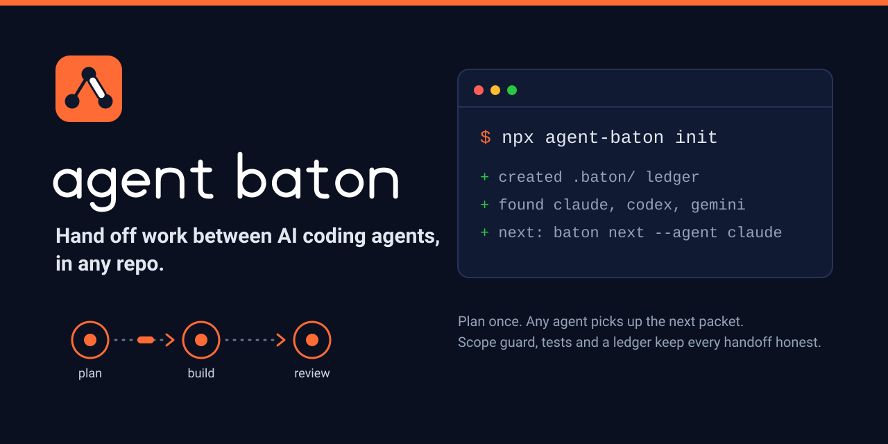

<div align="center">

<picture>
  <source media="(prefers-color-scheme: dark)" srcset="assets/logo-dark.svg">
  
</picture>

<br><br>



<br>

[](https://github.com/BhurkeSiddhesh/agent-baton/actions/workflows/ci.yml)
[](LICENSE)
[](package.json)
[](package.json)

</div>

**Agent Baton** installs a multi-agent workflow into any repository with one command. A goal is split into
**packets** that each own an exact list of files. Agents claim a packet, work inside its scope, pass a verify gate
(scope guard, secret scan, tests), and hand it to a *different* agent for review. Every step is an event in an
append-only, hash-checked ledger of one JSON file per event, so it merges cleanly under git and is shared by local and
cloud agents. Claude Code, Codex, Gemini CLI, Antigravity, Cursor, Copilot, Windsurf, Cline, Aider and OpenCode all
get thin adapter files that point at the same protocol. Zero runtime dependencies, Node 18 or newer, Windows, macOS
and Linux.

**Security boundary:** Agent Baton is **not a sandbox** or an identity/authorization system. Packet ownership, hooks, review names and ledger hashes reduce coordination errors but do not contain an agent with shell or repository-write access. Run untrusted workers with OS-level isolation and protect merges through GitHub policies. See the [security model](docs/SECURITY_MODEL.md) for enforced checks, bypasses and deployment guidance.

## 60-second quickstart

```bash
cd your-repo
npx github:BhurkeSiddhesh/agent-baton init       # works today, straight from GitHub
# npx agent-baton init                           # same thing once the package is on npm
```

`init` detects your stack, test command and installed agent CLIs, writes `.baton/`, a managed block in `AGENTS.md` and
the adapter files for each agent, and vendors the runtime into `.baton/runtime/` so everything afterwards runs with
no network and no install:

```bash
node .baton/runtime/bin/baton.js split "Ship invoice export" --out .baton/prompt.md   # or: plan add ...
node .baton/runtime/bin/baton.js check                                          # validate
node .baton/runtime/bin/baton.js next --agent claude                            # what to do now
```

Add `--yes` to skip prompts, `--dry-run` to preview every file, `--cloud` for GitHub workflows, `--hooks` for the
Claude Code ownership guard. Shortcut: `.baton/baton` (sh) and `.baton/baton.cmd` (Windows) wrap the same command, and
`npm run baton -- <command>` works in Node projects. The full walkthrough is in [docs/QUICKSTART.md](docs/QUICKSTART.md).

Prefer a bootstrap script? [install.sh](install.sh) and [install.ps1](install.ps1) check for Node 18+ and run the
same `npx` command.

## What you get

| Piece | What it does |
|---|---|
| **Plan** (`.baton/plan.json`) | Tracks, packets with exact `owns` lists, dependencies, gates, milestones. [Format](docs/PLAN_FORMAT.md). |
| **Packets and leases** | `begin` claims a packet with a lease; `heartbeat` extends it; a stale lease can be reclaimed. |
| **Ownership** | Two packets that can run together may not own the same file. `verify` flags anything outside scope. |
| **Verify gate** | Scope guard, protected paths, secret scan (files and branch history), your test command. `submit` needs a current pass. |
| **Independent review** | The reviewer is never the author. `accept`, `fix` or `reject`; open BLOCKER or MAJOR findings block acceptance. |
| **Audit mode** | When your queue is empty, `next` lists audit targets. Auditors file findings; they never edit audited files. |
| **Ledger** | One JSON file per event in `.baton/ledger/`, with a SHA-256 per event. Live state is derived by replay. |
| **Scoreboard** | `scores`, `release`, `digest` and `render` are pure views of the ledger. |
| **Adapters** | Native files for each agent: rules, subagents, slash commands, skills, workflows. [Per agent](docs/AGENTS.md). |
| **Cloud support** | `dispatch` turns a packet into a GitHub issue; optional workflows for CI, `@claude` and issue handoff. [Cloud](docs/CLOUD.md). |
| **Guard hook** | Optional pre-edit hook that denies edits outside the agent's packet. |
| **Safe install** | Never overwrites your files. Managed blocks, a manifest of hashes, `.baton-new` sidecars, `uninstall`. |

## Supported agents

| Agent | Adapter id | Instruction surface | Generated files |
|---|---|---|---|
| Claude Code | `claude` | `CLAUDE.md` block, subagents, slash commands, skill | 11 files plus the `CLAUDE.md` block |
| Codex CLI | `codex` | `AGENTS.md`, custom agents | 4 TOML files |
| Gemini CLI | `gemini` | `GEMINI.md` block, custom commands | 6 TOML files plus the block |
| Antigravity | `antigravity` | rules, workflows, skills | 11 files |
| Cursor | `cursor` | rule `.mdc`, commands | 7 files |
| GitHub Copilot | `copilot` | `copilot-instructions.md` block, agents, prompts | 10 files plus the block |
| Windsurf | `windsurf` | rules, workflows | 7 files |
| Cline | `cline` | `.clinerules/baton.md` | 1 file |
| Aider | `aider` | `CONVENTIONS.md` block, `.aider.conf.yml` if absent | 1 file plus the block |
| OpenCode | `opencode` | `AGENTS.md`, agents | 4 files |
| Anything else | `custom` | declared in `.baton/agents.json` | your template |

Details, detection rules and exact paths: [docs/AGENTS.md](docs/AGENTS.md).

## How it flows

<div align="center">

</div>

Plan, assign, begin, build, verify, submit, review, accept or reject, then merge. Every arrow is a ledger event.
[docs/WORKFLOW.md](docs/WORKFLOW.md) has the full lifecycle, review rules, audit mode, escalation and handoff.

## From a feature request to merged code: who orchestrates, and how do agents pick up work?

**Example request:** "Work on adding a CSV export feature, with validation and tests."

Agent Baton is a **coordination protocol and CLI**, not a background agent supervisor. The *orchestrator* is a role
(normally Claude, or a human) that plans and assigns work. The *workers* are coding agents you start locally or
dispatch through supported GitHub workflows. All actors read the **same plan** (`.baton/plan.json`) and share events
through the **ledger** (`.baton/ledger/` and the local store).

| Step | Who acts | What happens | Command / output |
|---|---|---|---|
| 1. Request | Human | States the feature goal | Natural-language goal to `baton split` |
| 2. Plan | Orchestrator (optionally AI-assisted) | Proposes tracks, small packets, file ownership, dependencies and done checks | `baton split "..." --run claude` → proposal file |
| 3. Approve | Human / orchestrator | Reviews, imports, assigns and commits the plan | `plan import`, `assign`, `check` |
| 4. Find work | Each agent **when started** | Reads the same ledger-backed queue; reviews and rework come before new build work | `baton next --agent codex` |
| 5. Claim | Worker | Creates or checks out its task branch, starts its packet, receives a lease and an ownership scope | `baton begin WP-001 --agent codex` |
| 6. Build | Worker | Edits *only* owned paths, commits the implementation and runs the verify gate | `baton verify WP-001`, `baton submit WP-001` |
| 7. Review | Different assigned reviewer | Inspects the exact commit, checks tests and evidence, records findings or verdict | `baton review WP-001`, then `accept` / `fix` / `reject` |
| 8. Integrate | Orchestrator / human | Fast-forwards the exact reviewed commit if it started at the integration tip; otherwise create a replacement packet | `baton merge WP-001` |
| 9. Publish ledger | Orchestrator / human | Exports and commits all lifecycle events on the integration branch so fresh clones replay the verdict | `baton ledger export`, `git add .baton/ledger`, `git commit` |
| 10. Repeat | Agents / orchestrator | Sync each worktree's plan with the integration branch, then read the queue again | `git merge --ff-only main`, `baton next` |

### A concrete walkthrough (manual / local agents, supported today)

Install in **your application's repository**. Choose installed agent adapters and an actual project test command
(`npm test` below is an example for a Node.js project):

```bash
cd your-app
npx github:BhurkeSiddhesh/agent-baton init --agents claude,codex --test-cmd "npm test" --yes
git add -A && git commit -m "Initialize Agent Baton"
```

**1. Turn the user's sentence into a reviewed plan.** The orchestrator can create a plan by hand or ask an installed
agent CLI to produce a *proposal*. The AI-assisted command **only generates the proposal**; it does not import it or
start workers.

```bash
node .baton/runtime/bin/baton.js split \
  "Add a CSV export feature with input validation and automated tests" --run claude
# Prints a path such as .baton/proposals/<timestamp>.json; use that actual path below.
node .baton/runtime/bin/baton.js plan import .baton/proposals/<timestamp>.json --dry-run
# Inspect/edit the proposal, then apply it explicitly:
node .baton/runtime/bin/baton.js plan import .baton/proposals/<timestamp>.json
node .baton/runtime/bin/baton.js assign --by human
node .baton/runtime/bin/baton.js check
git add .baton/ && git commit -m "Plan CSV export feature"
```

The plan records packet IDs such as `WP-001`, its `owns` paths, dependencies, completion checks, author and reviewer.
If you do **not** have an AI CLI, run `split "goal" --out .baton/prompt.md` to generate a planning prompt, or create
a track and packets manually with `plan track add` and `plan add`. A new project has **no tracks** until you create
or import them. See [Quickstart](docs/QUICKSTART.md).

**2. Start a coding-agent session and ask it to follow `AGENTS.md`.** Installation writes instruction/adaptor files
for the selected tools. The adapter explains the Baton protocol to that tool; **it does not itself spawn the tool**.
A running Codex session can execute:

```bash
node .baton/runtime/bin/baton.js check
node .baton/runtime/bin/baton.js next --agent codex
# Choose a READY packet actually assigned to codex (e.g. WP-001).
# IMPORTANT: start from the integration tip, not another feature or stale track branch.
git switch main
git pull --ff-only                    # when main tracks an accessible remote
git switch -c baton/WP-001-csv-export
node .baton/runtime/bin/baton.js begin WP-001 --agent codex
# Codex now implements the feature within WP-001's owns paths.
git add -A && git commit -m "Implement CSV export packet WP-001"
node .baton/runtime/bin/baton.js verify WP-001
node .baton/runtime/bin/baton.js submit WP-001 --agent codex
```

Do not reuse the same working tree for concurrent agents: use separate packet branches/worktrees. The owner and packet
number above are examples, **not** guaranteed output from `assign`. Actual agents must use their assignment from
`next`. For long-running work, run `baton heartbeat WP-001 --agent codex` to renew the lease.

**3. Start the assigned reviewer.** If the plan assigns Claude to review `WP-001`, Claude's session runs:

```bash
node .baton/runtime/bin/baton.js next --agent claude
node .baton/runtime/bin/baton.js review WP-001
# Check the exact commit, diff, tests and done checks; do not just trust the sign-off.
node .baton/runtime/bin/baton.js accept WP-001 --by claude --note "Reviewed commit and tests"
# Alternatively: baton fix WP-001 --by claude --note "..."
# Or:          baton reject WP-001 --by claude --note "..."
```

The orchestrator/human integrates accepted work, then **publishes the complete ledger**:

```bash
# First run on the packet's branch/worktree, once the separate reviewer accepted it:
node .baton/runtime/bin/baton.js merge WP-001 --by human

# Then in the MAIN worktree (not in the packet worktree):
git switch main                        # only if main is not checked out in another worktree
node .baton/runtime/bin/baton.js ledger export
node .baton/runtime/bin/baton.js ledger verify
git add .baton/ledger/
git diff --cached -- .baton/ledger/     # review exactly which events are being published
git commit -m "baton: publish WP-001 lifecycle events"
git push                                # if the integration branch has a remote
node .baton/runtime/bin/baton.js status
```

**Why the extra commit?** `verify`, `submit`, `accept` and `merge` append events **after** the worker's
implementation commit. Baton's `merge` fast-forwards `main` to that implementation commit, but **does not**
automatically commit these later `.baton/ledger/*.json` events. The commands above explicitly export the shared
local Git-common-directory event store into the tracked mirror, commit it on `main`, and push it. A fresh clone
then replays the accepted and merged state. This is **required for durable cross-clone handoff**; a green local status
without publishing the ledger is not enough. When working across separate clones, first reconcile/import the
remote event mirror and verify it—one clone's local events are not automatically visible in another clone.

**If `main` moved after acceptance:** do **not** follow the old `sync → verify → submit` advice. An `ACCEPTED`
packet cannot be begun, verified or resubmitted under the current state machine, and `sync` now rejects rewriting
its accepted commit. **Unfinished `IN_PROGRESS` packets are different:** they may rebase onto a newer `main`,
then freshly `verify` and `submit` for independent review; the original begin base must be in the integration
history, not on an unrelated feature branch. The supported recovery is to create a **new replacement packet** from updated `main` with
explicit ownership and a fresh `begin → verify → submit → independent accept → merge` cycle. Leave the old accepted
packet as unmerged history; do not present it as integrated. `baton sync` is for unfinished branches, not accepted
work. `submit` and a Baton verdict are **not a substitute** for GitHub branch protection or required PR approvals.

### How do other agents find and pick up tasks?

- **Local (Claude Code, Codex CLI, Gemini CLI, Antigravity, etc.):** launch the coding tool in the project, have it
  follow its generated instruction adapter and `AGENTS.md`, run `baton next --agent <id>`, and then `begin` its
  assigned packet. `next` presents reviews, rework, assigned ready packets, stretch work and audits. The instructions
  tell the agent how to behave; a separate agent session must exist.
- **GitHub / cloud:** initialize with `--cloud`, configure the provider's GitHub app, permissions and credentials;
  create the required label in the **dispatch destination repository** with
  `gh label create baton --repo owner/name --color 0969da` (use the destination's actual owner/name; skip if it
  already exists). **Check the packet's assigned author** with `baton review WP-001` before dispatching. If it is assigned
  to `codex`, use `baton dispatch WP-001 --to codex`, not `--to claude`: the target must match the assigned
  author's **provider kind**, while the issue preserves the exact author ID. For custom IDs (e.g. `claude-a` of kind
  `claude`), configure the receiving worker to use the matching `BATON_AGENT`; the generated `@claude` GitHub
  workflow sets `BATON_AGENT=claude` by default and needs customization before it can run as `claude-a`.
  To use a different provider, arrange an authorized `baton handoff WP-001 --to claude --by human` first and make
  sure the reviewer is **not** Claude (use `baton reassign` if needed). `dispatch` creates a GitHub **issue**;
  it does not universally launch a remote worker. The generated
  `@claude` workflow can be triggered when correctly configured; Copilot/Codex handoff depends on their respective
  integrations. See [Cloud agents](docs/CLOUD.md).
- **One orchestrator, many workers:** the orchestrator can plan and assign repeatedly, but does **not** automatically
  schedule continuously running agents. A human or external controller must start/poll their sessions and ensure they
  keep calling `next`. **Worktree plans are not shared automatically:** `.baton/plan.json` belongs to the checked-out
  branch, even when worktrees share the Git-common-directory ledger. After publishing new packets on `main`, start
  new packet worktrees from updated `main`, or explicitly synchronize each idle, clean worker branch using
  `git merge --ff-only main` before `baton next`; do not sync accepted or actively edited branches blindly.
  Leases and Git branches protect against ordinary coordination mistakes, not malicious code.

### What is automatic *today*, and what still needs a runner?

| Exists in the core CLI today | Requires a human, existing agent integration, or future execution controller |
|---|---|
| Planning prompt and optional AI-generated **proposal** | Turning an arbitrary chat/GitHub issue into an approved plan without invoking `split` |
| Packet assignment, dependency checks and `next` queue | Starting every assigned coding-agent CLI automatically |
| Packet leases, file-scope checks, secret scan, tests, review state and ledger | Continuously polling, heartbeating and supervising multiple live agent processes |
| GitHub issue dispatch and optional cloud workflows | Guaranteeing execution across arbitrary agent providers and accounts |
| Git worktree helpers, rebase and fast-forward integration | Automatic safe publication of late ledger events, and conflict-free global claims across disconnected cloud clones |

**End-to-end mental model:** You request a feature → Baton helps produce a plan → a human accepts it → agents **you
start or explicitly dispatch** read `next`, claim scoped packets, code and verify → another agent reviews → the
orchestrator merges accepted work. A fully autonomous "submit one sentence and watch an agent office work" controller
is a [future roadmap](docs/ROADMAP.md), not a current built-in feature.

## Example session

Two agents (`claude` orchestrates, `codex` reviews). Output is trimmed.

```console
$ baton plan track add --id docs --owner claude --owns docs/ --by human
added track docs
$ baton plan add --title "Docs" --track docs --owns docs/ --by human
added WP-001  Docs
$ baton assign --by human
WP-001   agent - -> claude              reviewer - -> codex               (lowest load; review load 0)
$ git checkout -b baton/WP-001-docs
$ baton begin WP-001 --agent claude
claude started WP-001
  lease until 2026-10-13T13:52:28Z
  owns: docs/
$ echo hi > docs/a.md; echo no > other.txt
$ baton verify WP-001
Verify WP-001: FAIL (scope mode: git-branch)
- OUT OF SCOPE or PROTECTED (revert, or post a REQUEST on the bus): other.txt
$ rm other.txt; git add -A; git commit -m docs
$ baton verify WP-001
Verify WP-001: PASS (scope mode: git-branch)
$ baton submit WP-001 --agent claude --note done
WP-001 is READY_FOR_REVIEW (commit 3c2e78e...). A sign-off and a release were posted.
$ baton accept WP-001 --by codex --score 9
WP-001 -> ACCEPTED by codex
$ baton scores
AGENT   START  READY  ACC  FIXES  REJ  REWORK  FIRST-PASS  REVIEWS(AVG)  ...
claude      1      1    1      0    0       0        100%             0
codex       0      0    0      0    0       0           -          1(9)
```

(`baton` stands for `node .baton/runtime/bin/baton.js`, or `npx agent-baton` outside an installed repo.)

## Documentation

- [Tested compatibility](docs/COMPATIBILITY.md) - verified Node/OS matrix and Windows shell smoke
- [Quickstart](docs/QUICKSTART.md) - install, plan, run your first packet
- [Engineering roadmap](docs/ROADMAP.md) - 88 scoped issues, priorities, prerequisites and release phases
- [Concepts](docs/CONCEPTS.md) - agents, tracks, packets, gates, ledger, bus
- [Workflow](docs/WORKFLOW.md) - the full lifecycle and the review rules
- [Commands](docs/COMMANDS.md) - every command and flag, from the real `--help`
- [Agents](docs/AGENTS.md) - per-agent setup, files written, custom agents
- [Cloud agents](docs/CLOUD.md) - ledger mirror, branches, dispatch, GitHub workflows
- [Plan format](docs/PLAN_FORMAT.md) - `plan.json` and `config.json` reference
- [FAQ](docs/FAQ.md) and [Troubleshooting](docs/TROUBLESHOOTING.md)
- [Security model](docs/SECURITY_MODEL.md) - trust boundaries, enforcement limits, threat scenarios and safer operation
- [Changelog](CHANGELOG.md), [Contributing](CONTRIBUTING.md), [Security](SECURITY.md), [Code of Conduct](CODE_OF_CONDUCT.md)
- Internals for contributors: [docs/internals/SPEC.md](docs/internals/SPEC.md), [LIB_API](docs/internals/LIB_API.md), [BRAND](docs/internals/BRAND.md)

## Design rules

- No network access and no secrets in the tool itself. `dispatch` and `split --run` only shell out to your own `gh` and agent CLIs, and both support `--dry-run`.
- Nothing is applied behind your back: `split` saves a proposal, you run `plan import`.
- Humans stay in charge: gates open only by their owner or `human`, and the orchestrator cannot override them.
- Every query command takes `--json` and prints exactly one JSON document. Exit codes: 0 ok, 1 rule violation, 2 usage error, 3 internal error.

## License

[MIT](LICENSE). Copyright (c) 2026 Siddhesh Bhurke.
